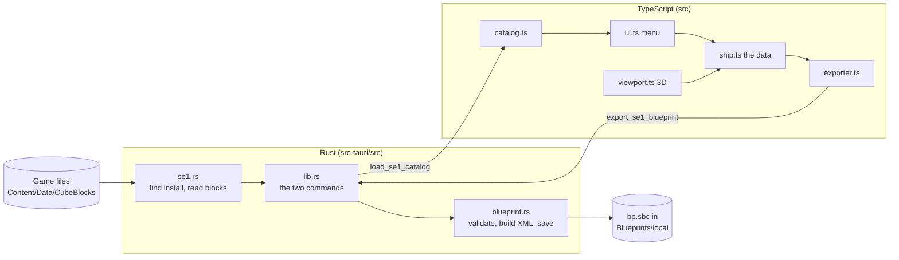

# Architecture

## The two halves
Tauri gives us two parts that run together as one desktop app:

- **Rust (backend)**, in `src-tauri/src`: touches the computer. Finds the game, reads files, writes the blueprint.
- **TypeScript (front-end)**, in `src`: everything you see. The 3D view, the menu, the buttons.

They never share memory. The front-end calls a Rust function by name with `invoke("name", { arguments })` and gets back a result (or an error) as JSON.

## File map
### Rust: `src-tauri/src`
| File | Job |
|---|---|
| `main.rs` | Generated start-up stub. Calls `lib.rs`. Do not edit. |
| `lib.rs` | Declares the three commands the front-end can call (`load_se1_catalog`, `load_block_icon`, `export_se1_blueprint`), and starts the app. |
| `se1.rs` | **Reading the game** (also decodes block icons from `.dds` to PNG).  Finds the install, lists the `CubeBlocks_*.sbc` files, parses each block (name, size), reads the game's menu categories from `BlockCategories.sbc`, looks up readable names in `MyTexts.resx`. Steps 1 and 2 of this file were written by you. See [[Walkthrough - se1.rs]]. |
| `armor.rs` | **Armor shapes.** Assembles slopes, corners and the other cube-side blocks from their side plates using a derived table of turns. See [[Armor Shapes and Sub-parts]]. |
| `mwm.rs` | **Reading 3D models.** Parses the game's `.mwm` files into triangles and packs them for the viewer. See [[Walkthrough - mwm.rs]] and [[MWM Model Format]]. |
| `blueprint.rs` | **Writing a blueprint.** Validates the ship, converts paint, builds the XML, refuses to overwrite, saves. See [[Walkthrough - blueprint.rs]]. |

### TypeScript: `src`
| File | Job |
|---|---|
| `main.ts` | Start-up: load the catalog, then create the ship, state, 3D view and menu. |
| `catalog.ts` | Types for blocks and the call to Rust. Has a small **sample catalog** used when running in a plain browser (no Rust there). |
| `ship.ts` | **The data.** Which block is in which cell (with its color and skin). Overlap checks, undo, and grouped edits that undo as one step. No drawing code. |
| `editorState.ts` | What is selected right now: tool, block, orientation, paint color. |
| `orientation.ts` | The 24 orientations and the rotation math. |
| `color.ts` | Hex colors to hue / saturation / value and back. |
| `viewport.ts` | **The 3D view** (Three.js). Draws boxes, previews the next block, turns clicks into edits. |
| `ui.ts` | **The side panel.** Game and grid size, tools, paint, block filters, export, keyboard shortcuts. |
| `modelLoader.ts` | Reads the model packet from Rust and builds three.js geometry (flips triangle winding, skips sticker parts). Caches models. |
| `blockMeshes.ts` | **The scene objects for the ship's blocks**: a drawn body (box, then real model) and an invisible pick box per block, with shared materials and a hover overlay. |
| `blockPlacement.ts` | Where a model goes: block center, rotation from the orientation, meters to cells, model offset. Pure math. |
| `areaTools.ts` | The Shift (floor) and Ctrl (wall) drag math: which axis the layer faces, which cells a rectangle covers and where blocks go to fill it. Pure functions. |
| `importer.ts` | Blueprint import: match blueprint blocks to the game's block list, move the ship to the origin, report what was left out. See [[Blueprint Import]]. |
| `textureLoader.ts` | Loads the game's textures (PNG from Rust's `load_block_texture`) once each. See [[Textures]]. |
| `viewGroups.ts` | Which blocks count as armor, and what a fade slider value means. See [[View Fading]]. |
| `limiter.ts` | Keeps only a few slow loads running at once. |
| `blockGrid.ts` | The block menu as a grid of picture tiles (game icon plus name). Loads icons only when scrolled into view. |
| `blockIcons.ts` | Asks Rust for a block's icon, limits how many load at once, remembers results. |
| `icons.ts` | Our own small SVG pictures for the toolbar (hammer, trash can, paint bucket, rotate arrows, grid sizes). |
| `sidebar.ts` | The drag-to-resize bar between the side panel and the 3D view. |
| `tooltip.ts` | One tooltip box drawn above the whole page for anything with `data-tooltip`. |
| `defaultPalette.ts` | The game's 14 default paint colors. |
| `exporter.ts` | Builds the JSON for the export command and sends it to Rust. |
| `styles.css`, `../index.html` | Layout and look. |
| `*.test.ts` | Automated tests (orientation, ship, color). |

See [[Walkthrough - TypeScript]].

## Data flow: opening the app
1. `main.ts` calls `loadSe1Catalog()`.
2. That calls the Rust command `load_se1_catalog` (in a plain browser it returns the sample list instead).
3. Rust: `find_install` then `load_catalog`, which parses about 49 definition files and the text table.
4. The list returns to TypeScript, and the menu fills.

## Data flow: block icons
1. `blockGrid.ts` creates one tile per block. A tile with no picture shows only its name.
2. When a tile scrolls near the visible area, it asks `blockIcons.ts` for the icon.
3. That calls the Rust command `load_block_icon` with the icon path from the block definition (for example `Textures\GUI\Icons\Cubes\light_armor_cube.dds`).
4. Rust checks the path (see [[Walkthrough - se1.rs]]), decodes the BC7 `.dds` and returns PNG bytes.
5. The bytes become a temporary image address; the tile fades its picture in. Blocks sharing an icon share one load.

## Data flow: block models
1. A block is placed: `blockMeshes.ts` immediately draws a colored box and adds an invisible pick box.
2. It asks `modelLoader.ts` for the block's model (path from the block definition).
3. That calls the Rust command `load_block_model`; `mwm.rs` reads the base file, follows `GeometryDataAsset` to the full-detail file, parses it, and returns the packed bytes.
4. TypeScript decodes the bytes, builds geometry (cached per model), and `blockMeshes.ts` swaps it onto the block with the matrix from `blockPlacement.ts`.
5. Armor-style blocks ask for `load_armor_model` instead (`armor.rs` turns and merges the side plates). Models with `subpart_` dummies (turrets, drills) also get their sub-parts added in `mwm.rs`.
6. Blocks whose model fails to load, and the interior wall, keep the box.

## Data flow: placing a block
1. Mouse moves: `viewport.ts` shoots a ray from the camera, finds the empty cell under the cursor, and shows a green or red ghost.
2. Click: `ship.place(...)` checks grid size and overlap, stores the block, records an undo step, and calls `onChange`.
3. `onChange` makes the viewport add a box and the menu update the block count.

## Data flow: exporting
1. `ui.ts` checks there are blocks and a name.
2. `exporter.ts` turns the ship into JSON: name, grid size, and for every block its type, subtype, position, orientation and paint.
3. Rust `export_se1_blueprint`: validates, builds XML, saves to `%APPDATA%\SpaceEngineers\Blueprints\local\<name>\bp.sbc`.
4. The result (saved path, or an error) goes back to the status line. If the name is taken, an explicit "Replace" button appears.

## The contract between the halves
The JSON field names in `exporter.ts` and the Rust structs in `blueprint.rs` must match exactly. A Rust test (`accepts_the_exact_json_the_front_end_sends`) fails if they drift apart.
